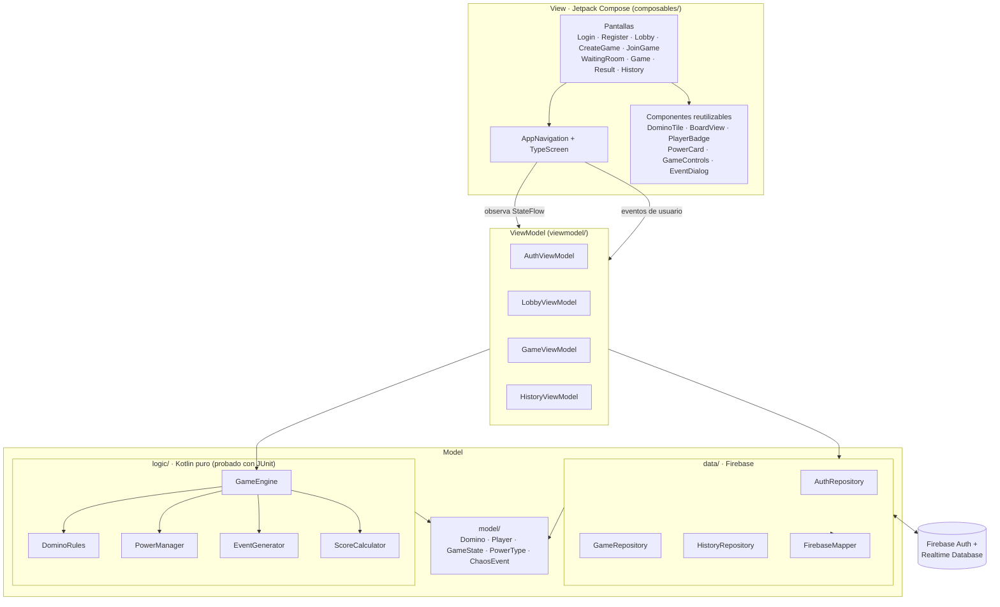
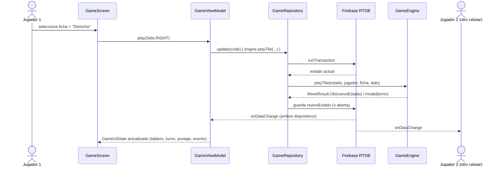
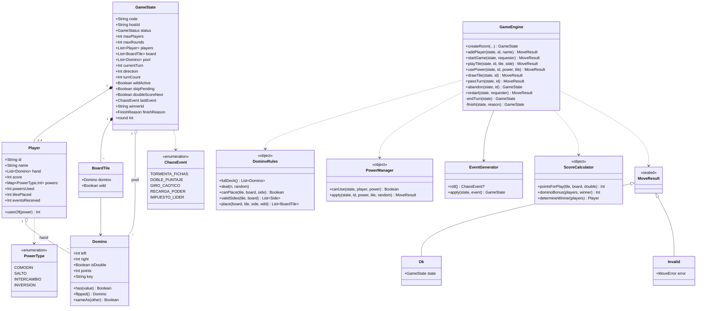
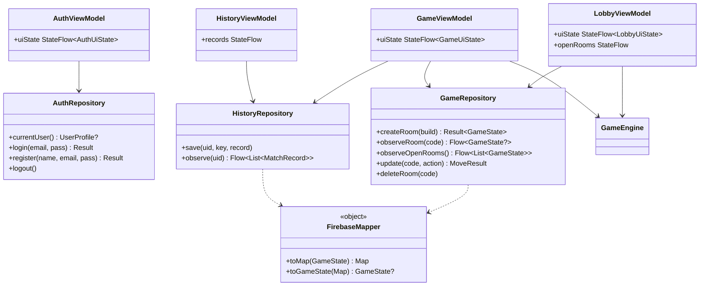

# Arquitectura de Dominó Caos

Base para las secciones de **especificaciones de diseño, arquitectura MVVM, diagrama de clases y componentes** del informe IEEE.

## 1. Capas (MVVM)

- **View**: funciones `@Composable` sin lógica de juego. Reciben un `UiState` y callbacks.
- **ViewModel**: expone `StateFlow<UiState>`; traduce acciones de la UI a llamadas del motor y del repositorio.
- **Model**: `model/` (entidades inmutables), `logic/` (reglas puras, sin Android) y `data/` (Firebase).

## 2. Flujo de una jugada en tiempo real

## 3. Diagrama de clases (modelo y lógica)

## 4. Diagrama de clases (datos y ViewModels)

## 5. Componentes reutilizables (UI)

| Componente | Responsabilidad | Usado en |
|---|---|---|
| `DominoTile` | Dibuja una ficha con Canvas (horizontal/vertical, seleccionada, jugable, comodín) | Login (logo), Tablero, Mano |
| `BoardView` | Mesa de juego con la cadena de fichas | GameScreen |
| `PlayerBadge` | Avatar, nombre, puntaje, fichas y resaltado de turno | GameScreen |
| `PowerCard`, `PowersButton`, `PowerSelectionDialog` | Selección y control de poderes con usos restantes | GameScreen |
| `HandView`, `GameControls`, `StatusChip` | Mano, botones Izquierda/Derecha/Robar/Pasar, efectos activos | GameScreen |
| `EventDialog` | Anuncio de evento aleatorio | GameScreen |
| `PrimaryButton`, `AppTextField`, `ScreenHeader`, `GlassCard`, `MenuCard`, `ChoiceChips`, `Avatar` | Controles comunes | Todas las pantallas |
| `UiMappings` | Traduce enums de la lógica a textos/iconos/colores (la lógica no depende de Android) | Todas |

## 6. Decisiones de diseño

1. **Estado inmutable + funciones puras** en `GameEngine`: cada acción devuelve un nuevo `GameState`, lo que permite probarlo sin Android y reutilizarlo dentro de una transacción de Firebase.
2. **Transacciones** (`runTransaction`) para todas las jugadas: si dos dispositivos escriben a la vez, Firebase reintenta con el estado más reciente.
3. **Fichas como texto `"a|b"`** en Firebase para que el tablero sea legible en la consola.
4. **Navegación por estado** con `TypeScreen` (misma metodología del proyecto HockeyGame), conectada a los `StateFlow` de los ViewModels.
5. **Eventos con contador** (`eventCounter`): todos los dispositivos muestran el diálogo una sola vez por evento.
